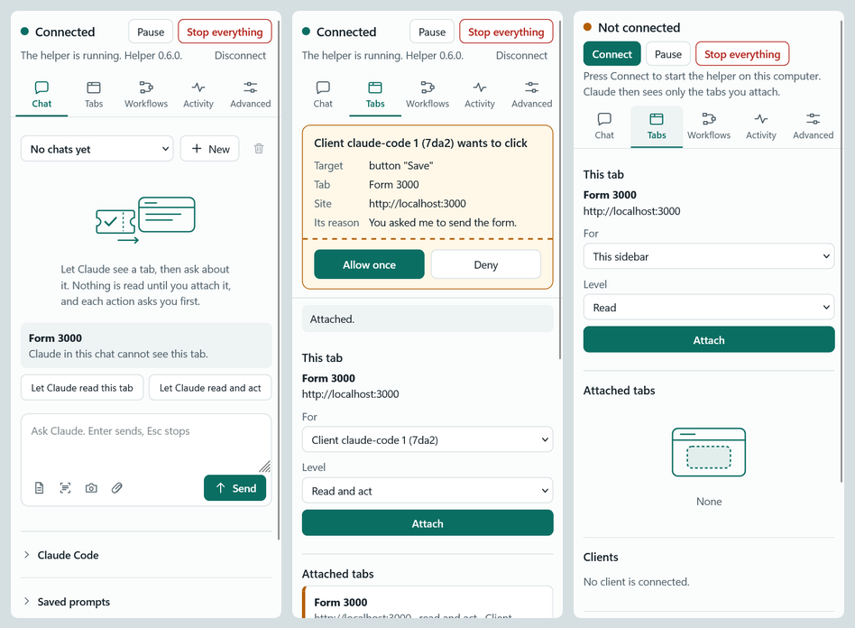

# Firefox Companion

Lets Claude work with the Firefox tabs you choose, and nothing else. You attach a tab in the Firefox sidebar, Claude reads it or acts in it, and every action that changes something waits for your Allow.

*Firefox Companion is a working name. It is not made, endorsed or supported by Mozilla or Anthropic.*



## Status

Version 0.6.0. Works on Windows 11 with Firefox 160 or later. **Not signed yet**: Firefox loads the add-on only as a temporary add-on, which is gone after a restart. Not published on addons.mozilla.org. Ready for local testing; not ready for public distribution ([what is open](docs/project-state.md)).

## How it works

- **The add-on** (`ext/`) holds the sidebar, the grants and the approval cards. Claude sees only tabs you attach to its session, at the level you choose: read, or read and act.
- **The helper** (`host/`), a small Windows program, connects the add-on to clients over a local pipe restricted to your Windows user (that other accounts are refused is not tested yet).
- **The MCP server** (`mcp/`) gives Claude Code or Claude Desktop the browser tools.
- **The sidebar chat** runs your own installed, signed-in Claude Code. The add-on holds no account and no key.

Site rules can keep sites away from Claude entirely. Pause and Stop everything end all work at once. File and shell tools in the chat are off unless you turn them on, and then each use asks too.

Optional and separate: an isolated Firefox, Windows input, a remote link between two computers (`backends/`, `remote/`), and a Thunderbird add-on (`thunderbird/`).

## Install and use

There are no prebuilt downloads yet. Build them as below, then follow **[SETUP.md](docs/SETUP.md)**: run the installer, load the add-on, press Connect, and connect Claude Code or Claude Desktop.

## Build and test

Needs Windows 11, Node 22 or later, Git, and the C# compiler that ships with Windows. No dependencies.

```powershell
npm run build      # dist/
npm run release    # unit tests, then release/ with checksums
npm test           # unit tests and package checks
```

The same commit gives the same bytes. All test suites, including the ones in real Firefox: **[DEVELOPMENT.md](docs/DEVELOPMENT.md)**.

## Documents

- [SETUP.md](docs/SETUP.md): installing, permissions, troubleshooting
- [DEVELOPMENT.md](docs/DEVELOPMENT.md): building, testing, reproducible builds
- [project-state.md](docs/project-state.md): what works, test results, what is open
- [RELEASE.md](docs/RELEASE.md): signing and the decisions before a public release
- [feature-parity.md](docs/feature-parity.md): every capability with its evidence

## License

[MPL-2.0](LICENSE). See [NOTICE.txt](NOTICE.txt) for third-party code (none) and trademarks. Firefox, Thunderbird and Mozilla are trademarks of the Mozilla Foundation; Claude and Anthropic are trademarks of Anthropic, PBC.
